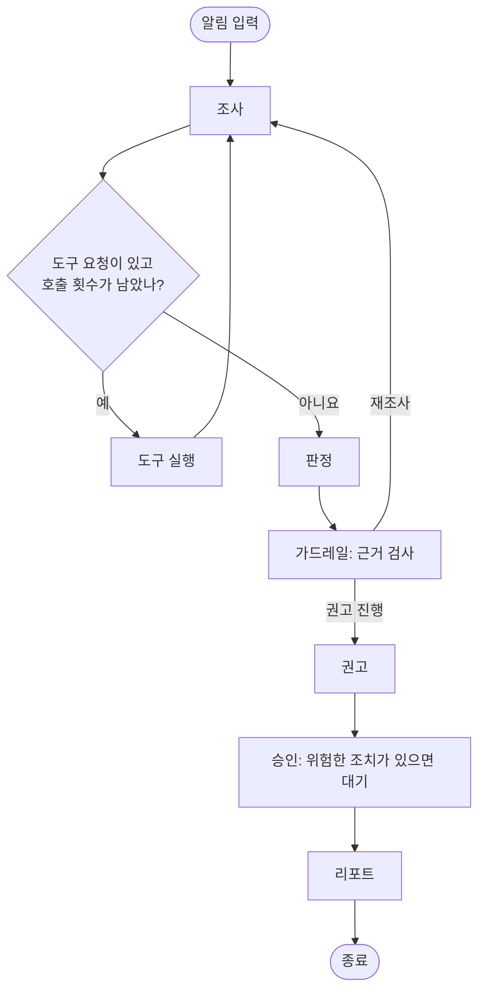

# 아키텍처

> 1일차 설계를 바탕으로 현재 구현된 그래프 흐름을 정리했다. 가드레일 근거 검사와 사람 승인 및 상태 저장은 2일차에 구현했다.

## 1. 에이전트 설계도

에이전트는 알림을 조사하고 판정 근거를 검사한 뒤 대응을 권고한다. 위험한 조치가 권고에 포함되면 사람의 결정을 기다린 후 리포트를 완성한다. 실행 환경에 따라 가짜 도구와 가짜 LLM을 사용해 흐름을 확인할 수도 있다.

기본 경로는 `조사 → 도구 → 조사 → 판정 → 가드레일 → 권고 → 승인 → 리포트`다. 도구 호출이나 재조사가 필요하면 일부 노드를 반복하고, 위험한 권고가 있으면 승인 노드에서 일시 중단한다. 그림은 `python -m soc.agent.graph`의 출력과 비교한 개념도다.

### 상태 (TriageState)

노드는 공유 상태를 읽고 필요한 항목을 갱신한다. 상세 형식은 `src/soc/agent/state.py`에 정의되어 있다.

| 상태 | 내용 |
| --- | --- |
| `alert` | 조사할 알림과 호스트, PID 등 |
| `messages` | AI의 조사 대화, 도구 호출과 결과 |
| `seen_event_ids` | 도구 결과에서 확인한 이벤트 ID |
| `tool_rounds` | 도구 실행 횟수 |
| `verdict` | 판정, 신뢰도, 기법, 근거 ID, 판정 이유 |
| `guardrail`, `guardrail_log`, `guardrail_retries` | 판정 검사 결과, 검사 이력과 재시도 횟수 |
| `playbook` | 검색한 대응 문서 조각과 출처 |
| `recommendation` | 추천 조치와 이유 |
| `approval` | 승인 필요 여부와 결정 |
| `report` | 최종 리포트 |
| `trace`, `usage` | 지나온 노드와 모델 사용량 |

### 노드와 상태

| 노드 | 하는 일 | 읽는 상태 | 쓰는 상태 | 쓰는 도구 | 운전 |
| --- | --- | --- | --- | --- | --- |
| 조사 | 알림과 대화를 보고 조사 도구 호출 여부를 결정한다. | `alert`, `messages` | `messages`, `trace`, `usage` | 가짜 LLM, 조사 도구 호출 요청 | 📘 문서 담당 |
| 도구 실행 | 요청된 조사 도구를 실행하고 반환된 이벤트 ID를 모은다. | `messages`, `tool_rounds` | `messages`, `seen_event_ids`, `tool_rounds`, `trace` | 가짜 조사 도구 4개 | 👥 함께 확인 |
| 판정 | 조사 결과를 바탕으로 판정과 근거를 작성한다. | `messages` | `verdict`, `trace`, `usage` | 가짜 LLM | 👥 함께 확인 |
| 가드레일 | 판정 근거를 검사한다. 조회하지 않은 근거, 근거가 없는 판정, 근거가 2개 미만인 악성 판정을 문제로 돌려준다. | `verdict`, `seen_event_ids`, `alert` | `guardrail`, `guardrail_log`, `trace` 등 | `guardrail.check()` | 👥 흐름 확인 |
| 권고 | 판정에 관련된 문서 조각을 찾고 대응 권고를 만든다. | `alert`, `verdict` | `playbook`, `recommendation`, `trace`, `usage` | 가짜 `search_playbook`, 가짜 LLM | 🔍 기록 담당 |
| 승인 | 위험한 조치가 있으면 사람의 승인 또는 거절을 기다린다. 없으면 대기 없이 진행한다. | `alert`, `verdict`, `recommendation` | `approval`, `trace` | `interrupt()` | 👥 함께 확인 |
| 리포트 | 알림, 판정, 근거, 권고와 승인 상태를 모은다. | `alert`, `verdict`, `guardrail`, `playbook`, `recommendation`, `approval`, `usage`, `tool_rounds`, `trace` | `report`, `trace` | — | 👥 함께 확인 |

## 2. 갈림길

- **도구를 더 호출할까?** 조사 결과에 도구 호출 요청이 있고 `tool_rounds`가 `max_tool_rounds`보다 작으면 도구를 실행한 뒤 다시 조사한다. 요청이 없거나 상한에 도달하면 판정으로 간다. 현재 설정의 기본 상한은 6회다.
- **가드레일이 실패하면?** 제공된 설정대로 문제를 알려 주고 한 번 재조사한다. 그래도 실패하면 조회하지 않은 근거를 빼고, 악성 판정이나 근거가 하나도 남지 않은 판정은 '의심'으로 낮춘 뒤 사람 검토 표시를 붙인다.
- **위험한 조치가 있으면?** 호스트 격리, 프로세스 종료, IP 차단, 비밀번호 초기화 중 하나가 권고에 있으면 `interrupt()`로 멈춘다. 승인 요청에는 알림 ID, 대상 호스트, 판정과 신뢰도, 기법, 근거 이벤트 ID, 위험한 권고 조치와 요약을 담는다. 승인 또는 거절 결과를 기록한 뒤 리포트를 만든다. 위험한 조치가 없으면 승인 대기 없이 진행한다.

### 승인 대기와 상태 저장

- PostgreSQL 체크포인터는 `PostgresSaver`와 `setup()`으로 필요한 테이블을 준비하고 그래프 상태를 저장한다. `CHECKPOINTER=memory`는 프로세스가 종료되면 상태가 사라진다. `auto`는 `BACKEND=real`이면 PostgreSQL을, 그렇지 않으면 메모리를 사용한다.
- 알림 ID를 `thread_id`로 사용한다. 승인 대기 중 앱이 재시작돼도 PostgreSQL 데이터가 유지되면, `POST /approvals/{alert_id}`로 승인 또는 거절을 보내 같은 작업을 재개할 수 있다. 서버 재시작만으로 자동 재개되지는 않는다.
- 재개할 때 승인 노드는 처음부터 다시 실행되고, `interrupt()`에서 사용자 결정을 받는다. 따라서 그 앞에 중복 실행되면 안 되는 작업을 두지 않는다.
- 승인은 권고에 대한 결정과 리포트 기록을 처리하며, 격리 등 실제 대응 조치를 실행하지는 않는다.

## 3. 배포 구성도 (2일차부터)
<!-- 01b 문서 2장의 그림을 실제 리소스(Deployment, StatefulSet, Job, Service, Ingress, Secret, ConfigMap)로 바꿔 그리기 -->
